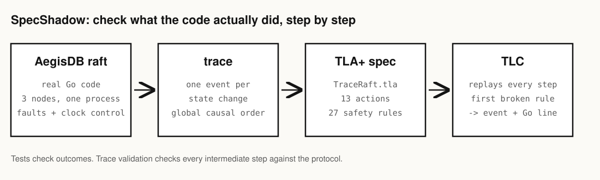
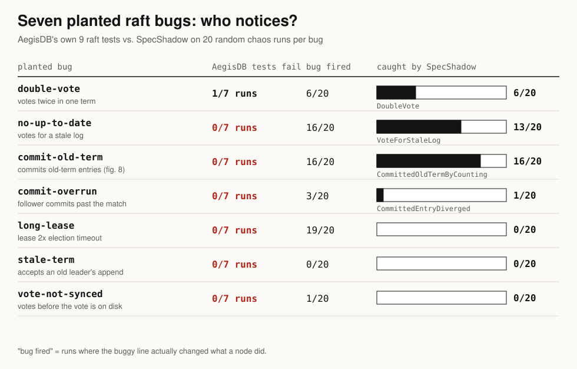
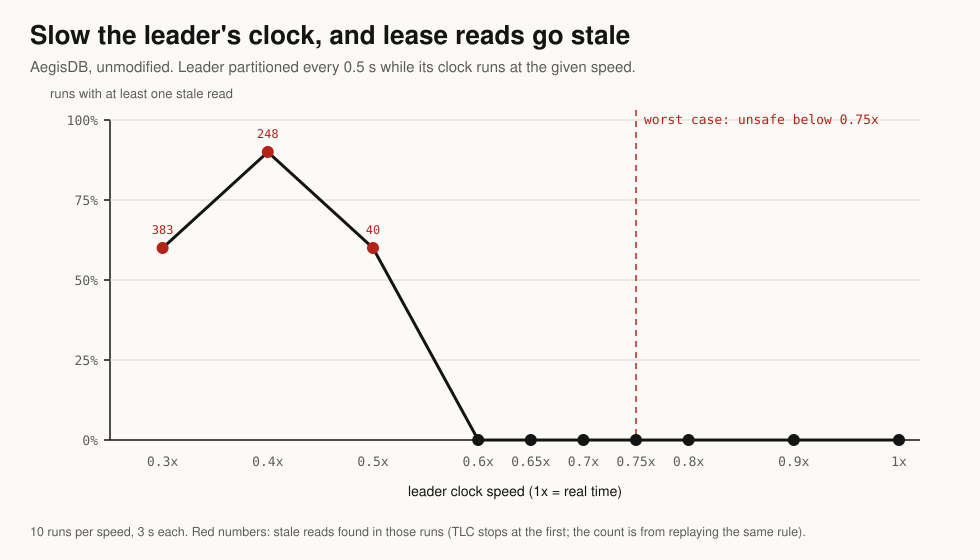
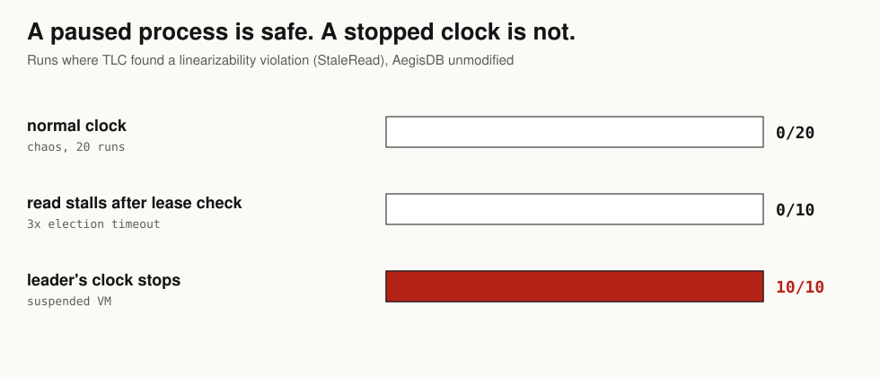

# SpecShadow

**Check what your distributed system actually did, one step at a time, against a TLA+ specification.**

SpecShadow runs [AegisDB](https://github.com/coolstack-coder/AegisDB) (my Raft key-value database in Go) under crashes, partitions, latency spikes and clock faults. It records every state change of every node, then has [TLC](https://github.com/tlaplus/tlaplus), the TLA+ model checker, replay that execution against a spec of Raft's safety rules. The first step that breaks a rule is reported with the rule, the event and the Go line that produced it.

<p align="center"></p>

▶ **[Demo video (55 s)](docs/specshadow-demo.mp4)**

```text
$ specshadow check -trace experiments/examples/freeze-freeze-none-r1.00-s301.ndjson.gz
VIOLATION: StaleRead at step 3071 of 9413 (TLC 2.3s)
  event #3073 at 1.108s: ReadServe on n3  (subject/raft/node.go:1118)
  last events before it:
       3063 n2  WriteAck        idx=353
       3064 n2  ClientRequest   term=2 role=L vote="n2" len=354 commit=353
       3065 n1  AppendOK        term=2 role=F vote="n2" len=354 commit=353 from=n2 mterm=2 prev=353 n=1
       3066 n1  Apply           term=2 role=F vote="n2" len=354 commit=353 lo=353 hi=353
       3067 n2  LeaderCommit    term=2 role=L vote="n2" len=354 commit=354 idx=354
       3068 n2  Apply           term=2 role=L vote="n2" len=354 commit=354 lo=354 hi=354
       3069 n2  WriteAck        idx=354
       3070 n3  ReadStart       term=1 role=L vote="n3" len=209 commit=209 rid=255
  >>>  3071 n3  ReadServe       term=1 role=L vote="n3" len=209 commit=209 rid=255 read_idx=209 lease=true
```

n3 led term 1 until its VM was suspended. n2 won term 2 and acknowledged writes up to index 354. n3 resumed, its stopped clock said its lease was still fresh, and it answered a read at index 209.

## What it found

**1. AegisDB serves stale reads when the leader's clock stops.** If the leader's VM is suspended (process and clock both stop) and then resumes, its read lease still looks valid. In **10 of 10** runs it served a read 122 to 145 writes behind what had already been acknowledged to a client, a linearizability violation. A leader whose clock runs at **half speed or slower** does the same (see the sweep below). This is unmodified AegisDB code.

**2. A correction to something I posted.** I had said the lease danger was a process that pauses right after checking its lease. SpecShadow says that case is safe: in **10 of 10** runs with every read stalled for 3 election timeouts after its lease check, **0** violations. 88 of those reads did return data older than writes acknowledged while they were paused, but those writes overlapped the read, so every one is still linearizable. A pause is not the problem. A clock that stops is.

**3. Seven planted Raft bugs.** Each is a small, realistic mistake switched on in AegisDB's code, run through 20 random chaos runs. SpecShadow raised **no false alarms on 20 correct runs** (89 elections, 88 crashes). On the planted bugs:

| planted bug | what it does | AegisDB's 9 raft tests fail in | bug fired (of 20 runs) | caught by SpecShadow | rule |
|---|---|---|---|---|---|
| `commit-old-term` | new leader skips its no-op and commits old-term entries by counting (Raft fig. 8) | 0 of 7 runs | 16 | **16** | `CommittedOldTermByCounting` |
| `no-up-to-date` | votes without the log up-to-date check | 0 of 7 runs | 16 | **13** | `VoteForStaleLog` |
| `double-vote` | grants a second vote in the same term | 1 of 7 runs | 6 | **6** | `DoubleVote` |
| `commit-overrun` | follower commits past the entries it just matched | 0 of 7 runs | 3 | **1** | `CommittedEntryDiverged` |
| `long-lease` | read lease = 2x election timeout | 0 of 7 runs | 19 | 0 | none broken |
| `vote-not-synced` | answers a vote before it is on disk | 0 of 7 runs | 1 | 0 | none broken |
| `stale-term` | accepts AppendEntries from an older term | 0 of 7 runs | 0 | 0 | never triggered |

AegisDB's own suite (9 tests, including its own randomized chaos test) was run 7 times per bug; only `double-vote` ever failed it, once (`TestPreVoteStopsDisruption`). Its suite also passed 7 of 7 times with no bug, so that failure is not noise from the suite itself.

"Bug fired" counts runs where the buggy line changed what a node did. Firing is not the same as breaking safety:

- `no-up-to-date` fired in 16 runs and was flagged in 13. The same helper also answers pre-votes, which change no state, so the other 3 are most likely pre-vote-only firings. I haven't confirmed that.

- `long-lease` ran in 19 runs and never caused a stale read. AegisDB's leader also steps down after losing contact with a quorum for one election timeout (CheckQuorum), so it stopped being leader before the over-long lease mattered. That defence in depth is a real property of the design, not a checker miss.
- `commit-overrun` fired 3 times. Twice the extra entries it committed happened to match the leader's log. Once they did not, and the state machines diverged.
- `vote-not-synced` crashed with an unsynced vote once, and that node never voted again before the run ended.
- `stale-term` needs a message delayed longer than an election, which this chaos schedule never produced.

<p align="center"></p>

## The clock-rate sweep

The leader is partitioned every 0.5 s while its clock runs at a given speed. Followers' clocks run normally.

<p align="center"></p>

AegisDB's lease is 0.75 of the election timeout, counted from when the leader *sent* its last acknowledged heartbeat, on the leader's clock. Followers refuse to elect anyone for one election timeout after hearing the leader, on *their* clocks. So in the worst case the lease is unsafe once the leader's clock runs slower than 0.75x. In practice none of 70 runs between 1.0x and 0.6x produced a stale read (about 62,000 reads), and the first ones appeared at 0.5x (6 of 10 runs, 40 stale reads). By 0.4x it was 9 of 10 runs and 248 stale reads; at 0.3x, 383 stale reads, the worst 65 writes behind. A new leader also has to time out, win a pre-vote and an election, and commit a write before a stale read can be observed, which adds slack.

<p align="center"></p>

## Why trace validation

A test checks an outcome at the end. Distributed-systems bugs live in intermediate steps: a vote granted twice, an entry committed one message too early. Most runs still end with the right answer.

A model checker explores a *model* of the protocol, which can be correct while the code isn't. Trace validation joins the two: record what the real code did, then ask the model checker whether that exact execution is one the spec allows ([Cirstea, Kuppe, Loillier, Merz, 2024](https://arxiv.org/abs/2404.16075)).

## How it works

**1. Instrument the real code** ([`subject/raft/instrument.go`](subject/raft/instrument.go)). AegisDB's raft node is copied in unchanged except for:

- one `emitLocked(...)` call at each state change,
- an injectable `Clock` used for every timing decision (elections, CheckQuorum, leader stickiness, the read lease),
- switches for the planted bugs.

With tracing off, it is AegisDB, and AegisDB's own raft test suite runs against this copy.

**2. Record one global order** ([`trace/`](trace/trace.go)). Each node emits while holding its own mutex, with its full post-state (term, role, vote, log terms, commit index). A recorder serialises the events. A reply is always handled after the request that caused it, so the order respects causality. A 3-second chaos run is about 2,000 to 10,000 events.

**3. Turn the trace into TLA+** ([`checker/tla.go`](checker/tla.go)). The trace becomes a `TraceData` module: a sequence of records, with each node's log delta-encoded against its previous event so a 10,000-step trace stays around 1 MB.

**4. Replay it in TLC** ([`spec/TraceRaft.tla`](spec/TraceRaft.tla)). The spec has 13 actions, one per event kind. Each action adopts the node's recorded state and checks the step against everything that happened before it. 27 rules in all, including:

- *elections:* `DoubleVote`, `VoteForStaleLog`, `LeaderWithoutQuorum`, `TwoLeadersInOneTerm`, `LeaderMissingCommittedEntry`
- *replication:* `AcceptedStaleLeader`, `LogMatching`, `CommitWithoutQuorum`, `CommittedOldTermByCounting`, `CommittedEntryDiverged`
- *state machine:* `AppliedUncommittedEntry`, `StateMachinesDiverged`, `AckedUncommittedWrite`
- *durability across crashes:* `LostVoteOnRestart`, `LostAckedEntriesOnRestart`
- *reads:* `StaleRead` (a read must see every write acknowledged before it started)

TLC walks the trace as a single behaviour. The first broken rule is printed with its step number, and the checker maps it back to the event and the Go line.

Every rule has a hand-written trace that must break it at exactly the right step ([`checker/check_test.go`](checker/check_test.go)), plus a correct history that must pass.

## Run it

Needs Go 1.23+ and Java 17+.

```bash
make tlc     # downloads tla2tools.jar into tools/
make test    # go vet + all tests (the spec tests run TLC)
make build

./specshadow run   -scenario chaos  -seed 7 -out /tmp/t.ndjson
./specshadow check -trace /tmp/t.ndjson

./specshadow run   -scenario chaos  -seed 7 -bug double-vote -out /tmp/b.ndjson
./specshadow check -trace /tmp/b.ndjson

./specshadow run   -scenario freeze -seed 1 -out /tmp/f.ndjson
./specshadow check -trace /tmp/f.ndjson

./specshadow eval  -out experiments/results.json   # everything above, ~10 minutes
```

Scenarios:

- `chaos`: partitions, crashes and restarts, packet loss and latency spikes
- `lease-rate -rate 0.5`: leader clock at half speed while partitioned
- `freeze`: leader's VM suspended and resumed
- `pause`: every read stalls after its lease check

## Results

All numbers come from [`experiments/results.json`](experiments/results.json) and [`experiments/results-sweep.json`](experiments/results-sweep.json), run on an Apple M2 laptop:

- 280 recorded executions
- 1,449,410 steps replayed by TLC
- 0.9 to 6.2 seconds of TLC per trace

The failing traces above are in [`experiments/examples/`](experiments/examples). Charts are generated by [`experiments/figures.py`](experiments/figures.py) and the video by [`experiments/video.py`](experiments/video.py).

## Limitations

- **Safety only.** The spec checks Raft's safety rules and linearizable reads. It does not check liveness, and it is not a full refinement mapping to a protocol spec: it trusts the recorded post-state and judges each transition.
- **Simulated network, clock and disk.** Nodes run as real goroutines on real time, but in one process. AegisDB's in-memory `simnet` is the network, a per-node `SimClock` is the clock, and `MemoryStorage` is the disk. A crash loses exactly what the code had not persisted. Torn writes and fsync lies are not modelled.
- **Not replayable by seed.** Goroutine scheduling isn't deterministic, so the recorded trace is the artifact, not the seed.
- **Planted bugs are synthetic,** and whether a run triggers one depends on the chaos schedule. That is why the table reports "fired" separately.
- AegisDB's log compaction is switched off while tracing.

## Layout

```
subject/raft     AegisDB's raft node + instrumentation (MIT, from AegisDB)
subject/simnet   AegisDB's in-process network
trace            event model and recorder
harness          cluster, clocks, faults, client traffic, scenarios
spec             TraceRaft.tla
checker          trace -> TLA+ module, TLC runner, report, rule tests
cmd/specshadow   CLI: run, check, eval
experiments      results, example counterexamples, figure and video scripts
```

## References

- H. Cirstea, M. A. Kuppe, B. Loillier, S. Merz. *Validating Traces of Distributed Programs Against TLA+ Specifications.* 2024. [arXiv:2404.16075](https://arxiv.org/abs/2404.16075)
- D. Ongaro, J. Ousterhout. *In Search of an Understandable Consensus Algorithm (Raft).* USENIX ATC 2014. Figure 8 and section 5.4.2 for `commit-old-term`.
- D. Ongaro. *Consensus: Bridging Theory and Practice.* PhD thesis, 2014. Section 6.4.1 on leases and bounded clock drift.
- L. Lamport. *Specifying Systems.* 2002. TLA+ and TLC.

MIT licensed.
